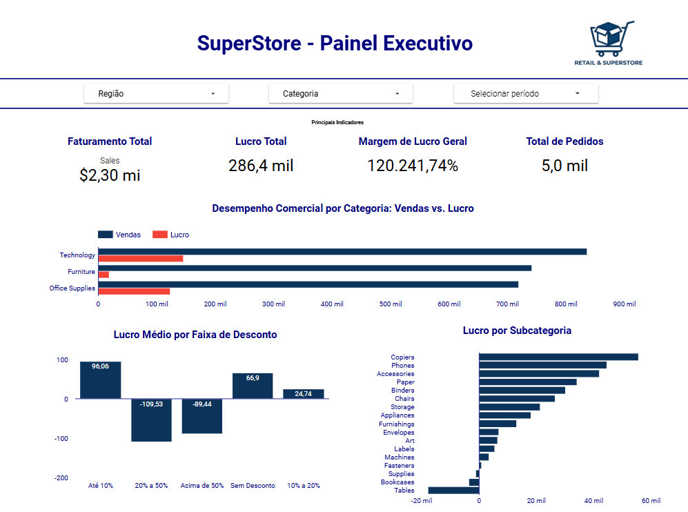

# Superstore Analytics: onde a margem de lucro se perde

Análise exploratória da base pública Superstore para entender por que um faturamento de US$ 2,30 milhões gera apenas 12,47% de margem, e qual parte desse resultado está ligada à política de descontos.

---

## 1. Problema de negócio

Uma rede de varejo vende em três categorias (Tecnologia, Material de Escritório e Móveis) e dá descontos para ganhar volume. O faturamento sozinho não mostra se cada venda deixou lucro. A pergunta do projeto é:

> **Quais categorias, subcategorias e níveis de desconto estão reduzindo o lucro, e o que a gestão pode revisar?**

Por que usar dados: sem cruzar desconto, produto e lucro por item, o prejuízo fica escondido dentro do total. O resultado geral é positivo (US$ 286 mil), mas esse número mistura vendas muito lucrativas com vendas que deram prejuízo.

---

## 2. Coleta de dados

| Item | Descrição |
| :--- | :--- |
| **Fonte** | Kaggle, [Superstore Dataset](https://www.kaggle.com/datasets/vivek468/superstore-dataset-final) (autor: vivek468) |
| **Método** | Download direto do arquivo `Sample - Superstore.csv` |
| **Tipo** | Dados estruturados (tabela única, 21 colunas) |
| **Tamanho** | 9.994 linhas; 5.009 pedidos distintos; período de 03/01/2014 a 30/12/2017 |
| **Moeda** | Dólar (US$) |
| **Licença** | Conferir na página do dataset no Kaggle antes de publicar o CSV no repositório |

---

## 3. Modelagem

A base é uma tabela única (flat). Não há joins.

- **Granularidade:** 1 linha = 1 item de um pedido (`Row ID` é único). Um pedido (`Order ID`) pode ter várias linhas. Por isso "itens" e "pedidos" são contagens diferentes: 9.994 itens e 5.009 pedidos.
- **Colunas criadas** (arquivo tratado, `dados/tratado/Superstore_Tratado.csv`):

| Coluna | Cálculo | Uso |
| :--- | :--- | :--- |
| `Shipping Days` | `Ship Date` − `Order Date`, em dias | Prazo de envio |
| `Profit Margin` | `Profit / Sales`, por linha | Olhar uma linha. Não serve para a margem geral |
| `Faixa_Desconto` | Sem desconto, Até 20%, 21% a 40%, Acima de 40% | Agrupar descontos |

- **Definição das métricas:**
  - **Margem consolidada** = soma de `Profit` ÷ soma de `Sales`. Nunca se soma nem se tira a média da coluna `Profit Margin`.
  - **Lucro médio** = média de `Profit` por item.
  - `Profit` é usado como vem na base. A base não informa se é lucro líquido nem traz custo do produto.

---

## 4. Análise exploratória (EDA)

### 4.1 Qualidade dos dados
Duplicados: 0. Valores nulos: 0. `Row ID` único. Nenhuma linha foi removida.

### 4.2 Visão geral
- Faturamento: **US$ 2.297.200,86**
- Lucro: **US$ 286.397,02**
- Margem consolidada: **12,47%**

### 4.3 Por categoria

| Categoria | Vendas (US$) | % das vendas | Lucro (US$) | Margem |
| :--- | ---: | ---: | ---: | ---: |
| Technology | 836.154,03 | 36,4% | 145.454,95 | 17,40% |
| Office Supplies | 719.047,03 | 31,3% | 122.490,80 | 17,04% |
| Furniture | 741.999,80 | 32,3% | 18.451,27 | 2,49% |

Furniture tem quase um terço das vendas e uma fração pequena do lucro.

### 4.4 Por subcategoria
Das 17 subcategorias, **3 dão prejuízo**:

| Subcategoria | Vendas (US$) | Lucro (US$) | Margem |
| :--- | ---: | ---: | ---: |
| Tables | 206.965,53 | −17.725,48 | −8,56% |
| Bookcases | 114.880,00 | −3.472,56 | −3,02% |
| Supplies | 46.673,54 | −1.189,10 | −2,55% |

Machines (margem 1,79%) fica positiva, mas perto de zero. As maiores contribuições de lucro vêm de Copiers (55.617,82), Phones (44.515,73) e Accessories (41.936,64).

### 4.5 Desconto

Lucro médio por nível de desconto:

| Desconto | Itens | Lucro médio (US$) |
| :--- | ---: | ---: |
| 0% | 4.798 | +66,90 |
| 10% | 94 | +96,06 |
| 15% | 52 | +27,29 |
| 20% | 3.657 | +24,70 |
| 30% | 227 | −45,68 |
| 40% | 206 | −111,93 |
| 50% | 66 | −310,70 |
| 70% | 418 | −95,87 |
| 80% | 300 | −101,80 |

Por faixa:

| Faixa | Itens | Pedidos | Lucro médio (US$) | Lucro total (US$) | Margem |
| :--- | ---: | ---: | ---: | ---: | ---: |
| Sem desconto | 4.798 | 2.644 | +66,90 | 320.987,60 | 29,51% |
| Até 20% | 3.803 | 2.507 | +26,50 | 100.785,47 | 11,91% |
| 21% a 40% | 460 | 400 | −77,86 | −35.817,47 | −15,30% |
| Acima de 40% | 933 | 737 | −106,71 | −99.558,59 | −77,40% |

O lucro médio muda de sinal **acima de 20%**: a 20% ainda é positivo (+24,70) e a partir de 30% passa a ser negativo. (Um pedido pode ter itens em faixas diferentes, por isso a soma da coluna Pedidos passa de 5.009.)

### 4.6 O desconto explica o prejuízo ou é o mix de produtos?
Dois cruzamentos ajudam a separar as duas hipóteses.

**Desconto × categoria (lucro médio por item, US$):**

| Faixa | Furniture | Office Supplies | Technology |
| :--- | ---: | ---: | ---: |
| Sem desconto | 69,54 | 41,71 | 158,88 |
| Até 20% | 19,91 | 17,65 | 55,59 |
| 21% a 40% | −90,35 | sem itens | −48,11 |
| Acima de 40% | −115,61 | −69,32 | −777,56 |

Nas três categorias, o lucro médio fica negativo acima de 20% de desconto. Isso indica que o padrão não vem de uma categoria só. Cuidado: em Technology, acima de 40%, são apenas 35 itens, e a média é puxada por poucos prejuízos grandes.

**Tables e Bookcases por faixa de desconto (US$):**

| Subcategoria | Desconto até 20% | Desconto acima de 20% |
| :--- | ---: | ---: |
| Tables | +12.973 (143 itens) | −30.698 (176 itens) |
| Bookcases | +7.625 (158 itens) | −11.098 (70 itens) |

As duas subcategorias são lucrativas quando o desconto fica até 20% e perdem dinheiro acima disso. A margem de **Furniture inteira**, considerando só itens com desconto até 20%, é de 13,34%, contra 2,49% no total.

**Supplies** é diferente: nenhum item tem desconto acima de 20% e mesmo assim a subcategoria dá prejuízo (−1.189,10). O desconto não explica esse caso. A base não permite dizer a causa.

### 4.7 Peso dos descontos altos
- 1.393 itens (13,9% das linhas) têm desconto acima de 20%. Eles somam 15,8% das vendas e **−US$ 135.376 de lucro**. Os demais itens somam **+US$ 421.773**.
- Dos 1.871 itens com prejuízo, 1.348 (72%) têm desconto acima de 20%.

---

## 5. Insights

| # | Achado | Tipo |
| :--- | :--- | :--- |
| 1 | Furniture tem 32,3% das vendas e 2,49% de margem | Fato |
| 2 | Tables, Bookcases e Supplies dão prejuízo | Fato |
| 3 | Itens com desconto acima de 20% somam prejuízo de US$ 135 mil, enquanto o restante soma US$ 422 mil de lucro | Fato |
| 4 | Tables e Bookcases são lucrativas até 20% de desconto e perdem acima disso | Fato |
| 5 | O desconto acima de 20% está **associado** ao prejuízo nas três categorias | Associação (não prova causa) |
| 6 | O prejuízo de Supplies tem outra origem, ainda não identificada | Hipótese a investigar |

## 6. Recomendações

Com base nos achados 3 a 5:

1. **Revisar a alçada de descontos acima de 20%.** Sugestão: exigir aprovação gerencial acima desse nível. O limite de 20% vem da análise. Os dados não permitem definir um valor "ótimo" exato entre 20% e 30%, porque quase não há itens com 25%.
2. **Olhar primeiro Tables e Bookcases.** Elas têm lucro positivo com desconto controlado, então o foco é a política de desconto delas, não necessariamente descontinuar o produto.
3. **Investigar Supplies com outros dados** (custo do produto, frete, devoluções), que não existem nesta base.

## 7. Limitações
- A base não tem custo do produto, frete nem devoluções, então não é possível separar a causa do prejuízo além do desconto.
- A análise mostra associação entre desconto e lucro. Não foi testado se reduzir o desconto manteria o volume de vendas.
- É uma base de exemplo (amostra). Conclusões servem para o exercício, não para uma empresa real.

---

## 8. Dashboard

Painel no Looker Studio: **[COLE AQUI O LINK DO SEU PAINEL]**



Como ler:
- **KPIs:** faturamento, lucro, margem consolidada (12,47%) e total de pedidos (5.009).
- **Vendas vs. lucro por categoria:** Furniture tem barra de vendas grande e barra de lucro minúscula.
- **Lucro médio por faixa de desconto:** a barra fica negativa a partir de "21% a 40%".
- **Lucro por subcategoria (as 17):** Tables, Bookcases e Supplies aparecem como barras negativas.

---

## 9. Como executar

```bash
pip install pandas
python main.py
```

Estrutura:

```
superstore_analytics/
├── dados/
│   ├── bruto/Sample - Superstore.csv   # original, não é alterado
│   └── tratado/Superstore_Tratado.csv  # gerado pelo script
├── main.py
└── README.md
```
